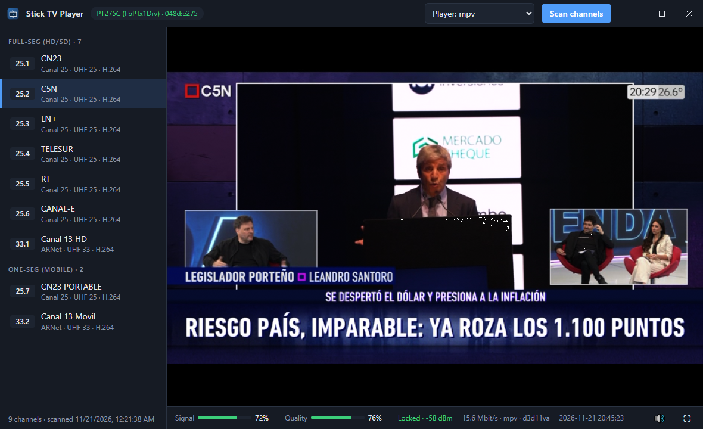

# Stick TV Player

A desktop app for watching ISDB-T (ISDB-Tb) TV with the portable USB tuner sticks built on the **ITE IT9175**,
the ones sold for Android phones. It scans channels, lists them and plays live TV. Video plays in an embedded
**mpv**, with the channel list and signal meters around it.



| Stick | USB id |
|---|---|
| MyGica/Geniatech PT275C (USB-C) | `048d:e275` |
| MyGica/Geniatech PT275, "GMA Now" (micro-USB) | `048d:275a` |

Tested in Argentina (UHF 14–51, 6 MHz, H.264 + AAC). Other ISDB-Tb countries that use the same channel raster
(Brazil, Peru, Chile, …) should work too. Windows for now; see [Linux](#linux).

## Installing (Windows)

1. **Bind the WinUSB driver to the stick (one time).** Windows has no driver for it; it shows up as
   "ISDB-T TV Stick". Plug it in and run [Zadig](https://zadig.akeo.ie/): *Options → List All Devices*, pick
   **ISDB-T TV Stick** (USB ID `048D E275` or `048D 275A`), choose **WinUSB** and click *Install Driver*.
   To undo it, uninstall the device in Device Manager and tick "delete the driver software". This doesn't affect
   using the stick with a phone.
2. **Install the app.** Download `Stick TV Player_<version>_x64-setup.exe` from
   [Releases](../../releases) and run it. It installs for the current user, no admin rights needed. The installer
   isn't code-signed, so SmartScreen may say "Windows protected your PC": click *More info → Run anyway*.
   To run it without installing, download `stick-tv-player_<version>_x64-portable.zip` instead, unzip it anywhere
   and run `stick-tv-player.exe`.

## Using it

1. Click **Scan channels**. It tries UHF 14–51 (~1.5 s per empty channel, a few seconds per multiplex) and
   saves the list.
2. Click a channel. Full-seg (HD/SD) and one-seg (mobile, low resolution) services are listed separately.

The last channel is tuned again on the next start. The status bar shows signal strength, quality, lock/dBm,
the multiplex bitrate, how the video is decoded, and the date and time sent by the station.

| Key | |
|---|---|
| ↑ / ↓, PgUp / PgDn | previous / next channel |
| F, double-click | fullscreen |
| Esc | leave fullscreen |
| M | mute |
| I | channel info |

**Players.** The selector in the top bar switches between **mpv** (default, included in the installer) and
**built-in**, which plays in the app's web view and needs `ffmpeg.exe` on PATH (e.g. `winget install Gyan.FFmpeg`).
The built-in player re-encodes the video, so it uses more CPU; it's there as a fallback.

### Troubleshooting

- **"OFDM processor does not answer"**: the demodulator inside the stick stopped responding. This can happen if
  the app is killed while playing. Unplug the stick and plug it back in.
- **Channels lock but no services are found**, or **"Waiting for the service…"** doesn't go away: the signal is too
  weak (the quality meter shows a few %). Move the antenna and scan again.
- **"Could not tune"** with an error like "not supported" or "access denied": the WinUSB driver isn't bound to the
  stick (step 1 above), or another program has it open.
- **Status bar says "mpv · CPU decode"**: mpv couldn't use the GPU decoder. It still plays, using more CPU.
- If mpv stops or its stream ends, the app restarts it and tunes the channel again (up to three times a minute).

The channel list (`channels.json`) and logs are in `%APPDATA%\io.github.tombpotochek.sticktvplayer\`:
`app.log` (channel changes, stream errors, dropped data, mpv restarts) and `mpv.log` (`mpv.prev.log` is the
previous run's). Attach them when reporting a problem.

## Linux

Not packaged yet. The driver and the built-in player are portable; the embedded mpv window is Windows-only so far.
Without a udev rule only root can open the stick. Create `/etc/udev/rules.d/60-stick-tv.rules`:

```
# ITE IT9175 ISDB-T sticks (PT275 / PT275C)
SUBSYSTEM=="usb", ATTRS{idVendor}=="048d", ATTRS{idProduct}=="e275", MODE="0660", TAG+="uaccess"
SUBSYSTEM=="usb", ATTRS{idVendor}=="048d", ATTRS{idProduct}=="275a", MODE="0660", TAG+="uaccess"
```

then `sudo udevadm control --reload && sudo udevadm trigger` and replug. To build, install the
[Tauri prerequisites for Linux](https://tauri.app/start/prerequisites/) and add `"deb"` or `"appimage"` to
`bundle.targets` in `src-tauri/tauri.conf.json`.

## Development

### Setup

- [Rust](https://rustup.rs/). The toolchain is pinned in `rust-toolchain.toml`; rustup installs it on first use.
- Node.js 18+.
- Windows: the MSVC build tools ("Desktop development with C++"). WebView2 comes with Windows 10/11.
- A player: `mpv.exe` on PATH (`winget install mpv`), and/or `ffmpeg.exe` for the built-in player.
- A stick bound to WinUSB, for anything beyond the unit tests.

```
npm install
npm run tauri dev                     # run the app (debug build, UI hot reload, right-click → Inspect)
npm run tauri build -- --no-bundle    # release build without an installer: target/release/stick-tv-player.exe
cargo test --workspace                # unit tests and driver diff tests, no hardware needed
```

`stick-cli` (in `crates/tuner`) drives the stick without the GUI, which is the quickest way to check the hardware:

```
cargo run -p stick-tuner --bin stick-cli -- list
cargo run -p stick-tuner --bin stick-cli -- scan --from 21 --to 36
cargo run -p stick-tuner --bin stick-cli -- tune 25 -o ch25.ts --seconds 10         # whole multiplex to a file
cargo run -p stick-tuner --bin stick-cli -- tune 25 --service E780 -o - | ffplay -  # one service
cargo run -p stick-tuner --bin stick-cli -- demux ch25.ts                           # services in a file
```

`-v` prints the driver log (firmware download, chip ids, register failures). `stick-cli reset` resets the USB port.

### Layout

```
crates/tuner/          the driver and TS handling (no GUI dependencies)
  src/afa.rs           IT9175 command framing
  src/usb.rs           device open, firmware download, init, tune, async TS streaming (rusb/libusb)
  src/it9175/          tuner/demodulator logic; data_*.rs are generated register tables
  src/ts/              packetizer, PSI sections, PAT/PMT/SDT/NIT, single-service filter
  src/channels.rs      UHF raster and channel scan
  src/bin/stick-cli.rs command-line tool
  tests/               diff tests against golden traces, demux tests
src-tauri/src/
  lib.rs               Tauri commands: device status, scan, play, stop
  hub.rs               local HTTP server streaming the filtered TS (127.0.0.1)
  mpv.rs               mpv process, its IPC, and the native video window
  transcode.rs         ffmpeg stage for the built-in player
src/                   UI (plain JS + CSS, Vite)
tools/gen-tables/      generator for the register tables and firmware images
tools/fetch-*.ps1      fetch mpv / ffmpeg for bundling into the installer
```

### How it works

```
 USB (WinUSB/libusb)           crates/tuner                         src-tauri                    UI
 EP 0x02 cmd OUT  ◄── afa: command frames + checksum
 EP 0x81 cmd IN   ──► usb: firmware download, init, tune
                      it9175: tuner/demod logic
 EP 0x84 TS IN    ──► usb::stream (16×64 KiB async) ──► demux → ServiceFilter ──► hub: 127.0.0.1/live.ts
                      ts: PAT/PMT/SDT/NIT                                             │
                                                        mpv (child window over the video area) ◄─┤
                                                        or ffmpeg → mpegts.js → <video>  ◄────────┘
```

- **Tuning.** The stick sends the whole multiplex. The backend demuxes it and keeps only the chosen service
  (its PMT, PCR, video and audio) behind a single-program PAT, served as a chunked `video/mp2t` stream on
  `127.0.0.1`.
- **mpv player.** One `mpv --wid` process draws into a native child window that the UI keeps on top of the video
  area, and is driven over its JSON IPC (a channel change is a `loadfile`). It plays the stream as broadcast: GPU
  decoding, deinterlacing only interlaced frames. The UI hides that window while it shows a message, since HTML
  can't draw over it. mpv's own key bindings are off; the app's keys are bound to `script-message`s that come back
  over IPC, so they work with the focus on the video.
- **Built-in player.** The channels here send interlaced H.264 as field pictures with open GOPs (the pictures right
  after an access point reference earlier ones). Chromium's decoder, which the web view uses, rejects that, so
  ffmpeg deinterlaces and re-encodes the video (GPU encoder if one works: NVENC, Quick Sync, AMF; else x264;
  `STICK_TV_ENCODER` forces one) and [mpegts.js](https://github.com/xqq/mpegts.js) plays the result through Media
  Source Extensions. Audio (AAC-LATM) is passed through.
- **Register tables.** `crates/tuner/src/it9175/data_*.rs` and the firmware images in `crates/tuner/data/` are
  generated by `tools/gen-tables` from OpenDTV's Java sources (`sh tools/gen-tables/gen.sh path/to/OpenDTV`).
  Don't edit them by hand.
- **Diff tests.** `crates/tuner/tests/diff_golden.rs` replays traces recorded from the vendor's own driver
  libraries (`tests/golden/`) and checks that the Rust tuner logic produces exactly the same register writes, for
  80 scenarios per stick.

### Packaging

```
npm run tauri build                   # installer without mpv (mpv then comes from PATH)
powershell -File tools/fetch-mpv.ps1  # pinned mpv build, SHA-256 checked, to src-tauri/binaries/ (gitignored)
npm run tauri build -- --config src-tauri/tauri.mpv.conf.json     # installer with mpv (what Releases ship)
```

At run time the app looks for mpv in `STICK_TV_MPV`, next to its executable (also `mpv\mpv.exe`), then on PATH;
for ffmpeg, next to its executable, then on PATH. `tools/fetch-ffmpeg.ps1` with `tauri.ffmpeg.conf.json` bundles
ffmpeg the same way.

## Contributing

Issues and pull requests are welcome.

**Reporting a problem.** Include the stick (USB id from the top bar), your country and the physical channel, the
signal and quality shown, and the output of `stick-cli -v list` / `stick-cli -v tune <channel> --seconds 5 -o x.ts`
if the stick misbehaves. A short `.ts` capture (a few MB) helps a lot with playback problems.

**Pull requests.**

- Keep them focused: one fix or feature per PR.
- Before opening one, run `cargo fmt --all`, `cargo clippy --workspace --all-targets` (no warnings) and
  `cargo test --workspace`.
- The diff tests must stay at 80/80 per stick. If you change the tuner logic in `crates/tuner/src/it9175/`, the
  register writes have to match the vendor traces; if they don't, the change is wrong, not the test.
- Don't edit the generated `data_*.rs` tables; change the generator in `tools/gen-tables/` and regenerate.
- There's no automated hardware test. Say in the PR what you tried on a real stick (which stick, which channels),
  or that you couldn't.
- `crates/tuner` has no GUI dependencies; keep it that way so `stick-cli` and other front ends can use it.

**Good places to help:** the embedded mpv window on Linux (X11/Wayland), packaging for Linux, captions (ARIB B24),
an EPG, recording, other IT9175-based sticks, and extracting the firmware at run time from a vendor APK the user
provides instead of shipping it (see below).

## Firmware

`crates/tuner/data/fw_pt275.bin` and `fw_pt275c.bin` are ITE's IT9175 firmware images, taken from the vendor's
Android drivers. The stick doesn't work without them. They belong to ITE, have no redistribution licence, and are
not covered by this repository's licence.

## Not supported

ALPU authentication (not used by these two sticks), crystal settings other than the two these sticks use,
EEPROM-configured variants, captions, EPG, recording. One stick at a time.

## Acknowledgements and licence

The IT9175 driver in `crates/tuner` is a Rust port of the Java driver in
[OpenDTV](https://github.com/jpdcs/OpenDTV) by jpdcs (MIT), including its register tables and test traces.
This project is MIT-licensed as well; see `LICENSE`, which keeps OpenDTV's copyright notice.
